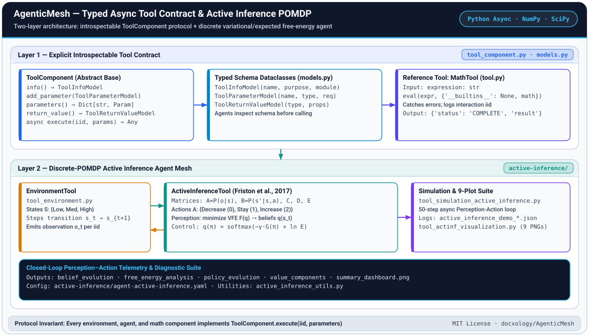

# AgenticMesh

Two layers: a small, explicit contract for tools that an agent can call, and a worked Active Inference agent built on top of it.

Start with the [documentation index](docs/README.md) for local setup,
tool contracts, the synthetic Active Inference model, and the
[manuscript](docs/manuscript/README.md).

The repository includes a dated synthetic run and diagnostic figures. The
arithmetic example accepts trusted expressions, and the Active Inference
demo acts within its local simulated environment.

Cite the software using [CITATION.cff](CITATION.cff).
